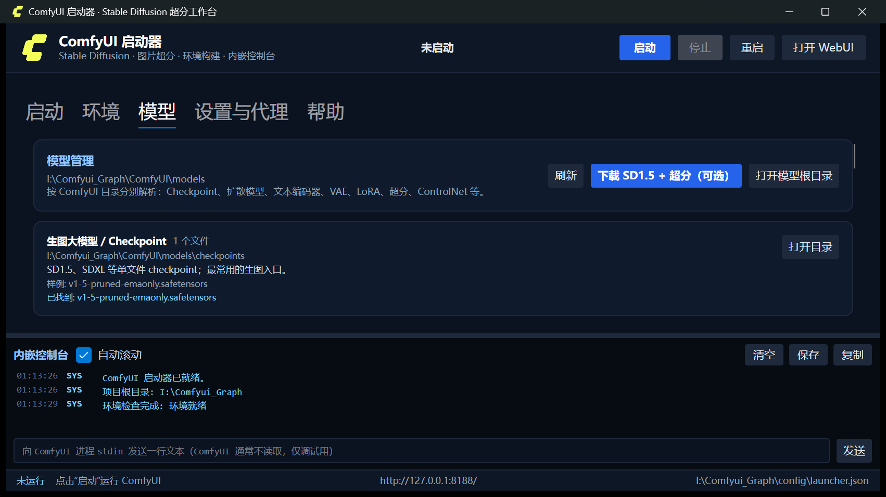

# ComfyUI SD Launcher


> 作者：**@1999Pt** · Copyright © 2026 @1999Pt
> 面向 Windows + NVIDIA/AMD/Intel 显卡的 ComfyUI 部署与启动器。

这是一个“装好就能画图/超分”的 ComfyUI 工作台：包含启动器、环境构建脚本、模型目录管理、Flux/SD 工作流示例。模型与 Python 运行时可随时重建，不依赖系统 Python。


---

## 1. 已配置环境

| 组件 | 版本 |
| --- | --- |
| Python | 3.12.10（内置 `runtime\python312`） |
| ComfyUI | 0.42.0（可切换 tag/branch/commit） |
| PyTorch | 2.9.1 + CUDA 13.0（RTX 4060 Laptop 实测） |
| 前端 | comfyui-frontend-package 1.57.1 |
| 模板 | comfyui-workflow-templates 0.11.93 |
| 启动器 | .NET 8 + Avalonia 11.3.22，v1.1.0.0 |

已验证：512×512 SD1.5 生图约 7 秒；4x-UltraSharp 将 512 放大到 2048；启动器启停正常。

---

## 2. 快速开始

1. 双击 `run-launcher.bat`；
2. 首次打开若显示“环境就绪”，直接点右上角 **启动**；
3. 状态变为 **运行中** 后点 **打开 WebUI**（默认 `http://127.0.0.1:8188/`）；
4. 关闭启动器会同时结束 ComfyUI 进程。

如果环境不完整，进入 **环境** 页，选择 CUDA/后端组合后点 **一键构建**。模型下载默认关闭，可在“模型”页单独执行。

> `run-launcher.bat` 会优先通过 `dotnet ComfyLauncher.dll` 启动，避免直接运行未签名 EXE 被 SmartScreen/Smart App Control 拦截。若你直接双击 `launcher\publish\ComfyLauncher.exe` 出现“无法验证发布者”或长时间无响应，请改用 `run-launcher.bat`；需要正式分发时请给 EXE 做代码签名。

命令行方式：

```powershell
# 启动
powershell -ExecutionPolicy Bypass -File .\scripts\start-comfy.ps1

# 环境检查
powershell -ExecutionPolicy Bypass -File .\scripts\check-env.ps1
```

---

## 3. 启动器

### 3.1 目录与用户目录

| 项 | 说明 |
| --- | --- |
| ComfyUI 目录 | 源码/工作目录 |
| 内置 Python | 用于创建 `.venv` |
| 虚拟环境 | 实际运行 ComfyUI 的 `.venv` |
| 用户目录 | `--user-directory`，保存工作流/界面设置 |
| 模型目录 | 留空 = `ComfyUI\models`；可指定外部目录 |
| 输出/输入目录 | 分别覆盖 ComfyUI 默认目录 |

设置保存到 `config\launcher.json`，路径可以随时修改。

### 3.2 启动参数

端口、监听地址、显存模式、精度、实时预览、注意力后端、日志级别、额外参数都可配置；底部实时显示完整命令，可复制。

### 3.3 内嵌控制台与主题

- stdout/stderr 着色、自动滚动、保存/复制、stdin 调试；
- **启动行为 → 服务就绪后自动打开 WebUI**：以系统默认浏览器的链接方式打开，使用 `asInvoker` 权限，不请求管理员权限，避免浏览器出现“权限/重启”提示；
- **设置与代理 → 界面主题** 可切换深色/浅色，立即生效并保存；
- 控制台、日志文本、窗口标题栏、窗口图标都会随主题切换；
- 使用透明 ComfyUI Logomark：深色主题黄色、浅色主题深色，不再有黑色背景上的白框。

### 3.4 环境构建

环境页提供：

- **Torch 组合**：CUDA 13.0 / 12.8 / 12.6 / 12.4、DirectML、CPU；
- **ComfyUI 版本**：留空最新，或填写 `v0.42.0`、分支、commit；
- **构建时下载推荐模型**：可选，默认不下载；
- 分步执行：Python → ComfyUI → venv → PyTorch/依赖 → 模型（可选）→ 检查。

| 组合 | PyTorch 索引 | 启动参数 |
| --- | --- | --- |
| CUDA 13.0 + torch 2.9.1 | `cu130` | 默认 |
| CUDA 12.8 + torch 2.9.1 | `cu128` | 默认 |
| CUDA 12.6 + torch 2.9.1 | `cu126` | 默认 |
| CUDA 12.4 + torch 2.6.0 | `cu124` | 默认 |
| DirectML | `torch-directml` | `--directml` |
| CPU | `whl/cpu` | `--cpu` |

> DirectML 适合部分 AMD/Intel 显卡，但并非所有 ComfyUI 节点都支持，速度通常低于 CUDA；切换后端后请重新执行第 4 步安装。

命令行构建：

```powershell
# 默认不下载模型
powershell -ExecutionPolicy Bypass -File .\scripts\bootstrap.ps1

# 同时下载 SD1.5 + 两个超分模型
powershell -ExecutionPolicy Bypass -File .\scripts\bootstrap.ps1 -WithModels
```

---

## 4. 模型管理

“模型”页按 ComfyUI 目录分别解析，显示文件数量、实际文件名和样例，并提供 **打开目录** 按钮。



| 目录（在 `ComfyUI\models\` 下） | 用途 | 文件样例 |
| --- | --- | --- |
| `checkpoints` | SD1.5 / SDXL 单文件大模型 | `v1-5-pruned-emaonly.safetensors` |
| `diffusion_models` | Flux、SD3 等分离式扩散模型 | `flux1-dev.safetensors` |
| `text_encoders` | 文本编码器（语言解释器） | `clip_l.safetensors`、`t5xxl_fp16.safetensors` |
| `vae` | 潜空间解码器 | `ae.safetensors` |
| `loras` | Flux/SD 的 LoRA | `flux_style.safetensors` |
| `upscale_models` | 4x 超分模型 | `4x-UltraSharp.pth` |
| `controlnet` | ControlNet | `control_v11p_sd15_canny.pth` |
| `clip_vision` | CLIP Vision（IP-Adapter） | `clip_vision_g.safetensors` |
| `embeddings` | Textual Inversion | `easynegative.safetensors` |

旧版 ComfyUI 的 `models\unet`、`models\clip` 也会被识别并计入对应分类。

### 4.1 Flux 分离式模型

Flux.1-dev 不是单个 checkpoint，按以下方式放置：

```text
ComfyUI\models\diffusion_models\flux1-dev.safetensors
ComfyUI\models\text_encoders\clip_l.safetensors
ComfyUI\models\text_encoders\t5xxl_fp16.safetensors
ComfyUI\models\vae\ae.safetensors
ComfyUI\models\loras\flux_style.safetensors   # 可选
```

放置后在“模型”页点 **刷新**，重启 ComfyUI，再加载 Flux 工作流。

### 4.2 可选下载

“下载 SD1.5 + 超分（可选）”会下载：

- `checkpoints\v1-5-pruned-emaonly.safetensors`
- `upscale_models\4x-UltraSharp.pth`
- `upscale_models\RealESRGAN_x4plus.pth`

Flux 模型体积大且受 HuggingFace 许可约束，请自行从官方仓库下载后放入上表目录；启动器只负责目录识别。

---

## 5. 图片超分辨率

1. 启动 ComfyUI，打开 WebUI；
2. 加载 `workflows\upscale_4x.json`；
3. Load Image 选择图片；
4. Upscale Model 选择 `4x-UltraSharp.pth` 或 `RealESRGAN_x4plus.pth`；
5. Queue，结果保存到 `output\upscaled\`。

批量：

```powershell
.\.venv\Scripts\python.exe .\scripts\batch_upscale.py .\input --recursive `
  --model 4x-UltraSharp.pth --output-dir .\output\upscaled
```


---

## 6. 简单生图

1. 加载 `workflows\txt2img_sd15.json`；
2. 修改正/负提示词；
3. 默认 512×512、25 步、euler/normal、CFG 7；
4. Queue，结果在 `output\sd15\`。


8GB 显存建议先 512×512；OOM 时选“低显存”或缩小尺寸。

---

## 7. Git 代理

克隆/更新 ComfyUI 时：

```
直连 → 15 秒无响应或持续 < 80 KB/s
     → 检查 127.0.0.1:10108
       → 可达：代理重试一次
       → 不可达：明确提示
```

地址、超时、最低速率可在 **设置与代理** 页修改。

> 本机部署时 10108 未监听，实际克隆走直连；模型下载使用系统代理 `127.0.0.1:10808`。

---

## 8. 常见问题

**打开目录报 `explorer.exe 0xc0000142`？**
本版本优先使用 Shell COM（`Shell.Application.Explore`）复用现有资源管理器，不再直接启动 `explorer.exe`；若仍失败，请确认系统资源管理器可用。

**双击 EXE 长时间无响应 / 提示无法验证发布者？**
这是未签名 EXE 被 Windows SmartScreen/Smart App Control 检查导致的。请双击 `run-launcher.bat`（通过微软签名的 dotnet 主机加载 DLL），或运行 `scripts\unblock-launcher.ps1` 解除下载锁定；正式分发需要受信任的代码签名证书，可参考 `scripts\sign-launcher.ps1`。

**端口被占用？**
修改监听端口，或结束占用进程：`Get-NetTCPConnection -LocalPort 8188`。

**切换 CUDA/后端后没生效？**
环境页第 4 步会重新安装所选组合；切换后重新执行并重启 ComfyUI。

**Flux 模型放哪里？**
按第 4.1 节；`diffusion_models` 放主模型，`text_encoders` 放 CLIP-L/T5，`vae` 放 `ae.safetensors`。

**DirectML 能用吗？**
可以安装并启动，但节点兼容性和速度取决于显卡/驱动；NVIDIA 用户优先 CUDA。

**启动器文件属性显示发布者吗？**
显示 `@1999Pt`；Windows 首次运行的“未知发布者”来自未做代码签名，需要受信任证书签名才能消除。

---

## 9. 目录结构

```text
<安装目录>\
├─ run-launcher.bat
├─ runtime\python312\          # 内置 Python
├─ .venv\                      # ComfyUI 虚拟环境
├─ ComfyUI\                    # 源码 + models
├─ launcher\                   # Avalonia 启动器源码/发布产物
├─ workflows\                  # 超分/生图工作流
├─ scripts\                    # 环境构建、启动、批量超分
├─ config\launcher.json        # 本机配置
├─ user\ input\ output\        # 用户/输入/输出
├─ cache\ temp\ logs\          # 缓存/临时/日志
└─ docs\                       # 截图与图标
```

开发、构建、发布、代码签名和二次开发说明见 [developer.md](developer.md)。

---

## 10. 许可

- 启动器代码：Copyright © 2026 **@1999Pt**。
- 更新日志：[updata.md](updata.md)。
- ComfyUI：GPL-3.0；SD1.5：CreativeML Open RAIL-M；Flux 与其他模型遵循各自许可证。
- 生成内容请遵守模型许可与当地法律。
