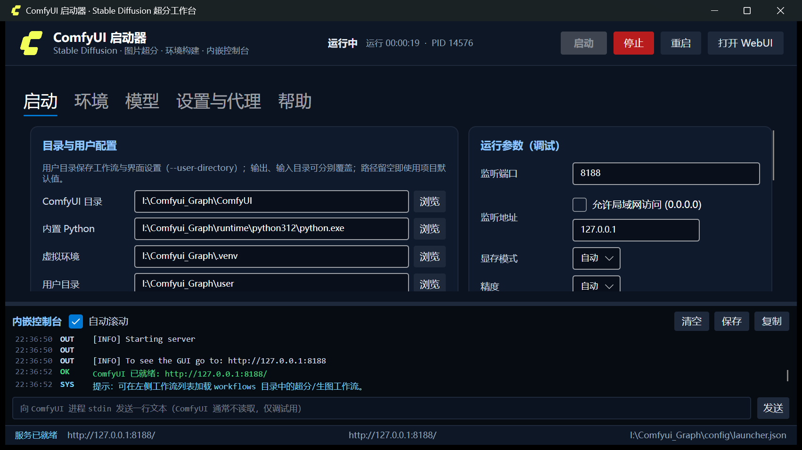
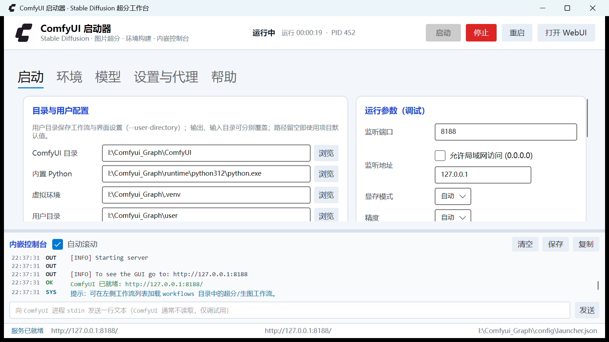

# ComfyUI SD Launcher · Comfyui-SD-19Pt


> 作者/维护者：**@1999Pt** · 版权：Copyright © 2026 @1999Pt
> 仓库：<https://github.com/Kalcite/Comfyui-SD-19Pt>

一套面向 **Windows + NVIDIA 显卡** 的 ComfyUI 部署与启动器项目，目标是把“图片超分辨率 + 简单生图”做成可复用的工程，而不是只在一台机器上能跑的临时环境。

项目包含：

1. **Avalonia 启动器**：目录/用户目录配置、启动参数调试、内嵌控制台、环境构建；
2. **部署脚本**：内置 Python 运行时、独立 venv、CUDA PyTorch、ComfyUI 依赖、模型下载；
3. **工作流**：4x 超分与 SD1.5 生图，同时提供界面版与 API 版；
4. **Git 智能代理**：15 秒无响应或速率过低时切换 `127.0.0.1:10108`。





---

## 1. 仓库内容 vs 本机部署环境

这是本项目最重要的一条边界：**仓库只提交项目文件，不提交本机运行数据/模型/密钥**。

| 提交到仓库 | 说明 |
| --- | --- |
| `launcher/ComfyLauncher/` | Avalonia 启动器源码、图标、csproj |
| `scripts/` | Python/ComfyUI/依赖/模型/启动脚本 |
| `workflows/` | 界面版与 API 版工作流 JSON |
| `docs/` | README 截图与 logo |
| `ICO/` | 原始 ComfyUI 图标与 SVG 源文件 |
| `config/launcher.example.json` | 配置模板（路径留空） |
| `requirements.lock.txt` | 当前验证过的依赖精确版本 |
| `run-launcher.bat`、`README.md`、`.gitignore` | 入口与文档 |

| 不提交（本机部署环境） | 原因 |
| --- | --- |
| `runtime/` | 内置 Python 3.12.10，约 86 MB，可由脚本重建 |
| `.venv/` | 依赖环境，约 4 GB，可由脚本重建 |
| `ComfyUI/` | 上游源码，由 `setup-comfy.ps1` 克隆 |
| `ComfyUI/models/`、根目录 `models/` | 模型体积大且受各自许可证约束，由 `setup-models.ps1` 下载 |
| `cache/`、`temp/`、`logs/` | 本机缓存与日志，可能含绝对路径 |
| `output/`、`input/`、`user/` | 用户图片/工作流/界面设置 |
| `config/launcher.json` | 含本机绝对路径，不提交 |
| `launcher/**/bin|obj|publish/` | 构建产物 |

> 仓库 clone 下来后是“项目骨架”，执行一次部署脚本即可生成完整的本机环境；也可以由内部部署系统预置 `runtime`、`.venv`、`ComfyUI`、模型，只更新项目文件。

---

## 2. 项目结构

```
Comfyui-SD-19Pt/
├─ run-launcher.bat                  # 双击入口：Release → publish → Debug → dotnet run
├─ README.md
├─ requirements.lock.txt             # 当前环境的依赖精确版本
├─ .gitignore
│
├─ ICO/                              # ComfyUI 图标源文件
│  ├─ Logomark yell.ico / .svg       # 透明 Logomark，黄色（深色主题）
│  ├─ Logomark Ink.ico / .svg        # 透明 Logomark，深色（浅色主题）
│  ├─ Icon ink.svg / Icon yellow.svg # 方形图标源
│  └─ Core logo ink / Yellow         # 横向字标（文档/品牌）
│
├─ launcher\
│  └─ ComfyLauncher\
│     ├─ ComfyLauncher.csproj        # .NET 8、Avalonia 11.3.22、发布者/版权/图标
│     ├─ Assets\
│     │  ├─ logomark-yellow.ico      # 深色主题窗口图标（透明）
│     │  ├─ logomark-ink.ico         # 浅色主题窗口图标（透明）
│     │  └─ app.ico                  # EXE 文件图标（深色圆角底，无白边）
│     ├─ Program.cs / App.axaml(.cs)
│     ├─ Views\MainWindow.axaml(.cs) # 全部界面与内嵌控制台
│     ├─ ViewModels\MainViewModel.cs # 状态、命令、进程与构建编排
│     ├─ Models\                     # AppSettings / LogLine / StatusItem / ModelItem
│     ├─ Services\                   # 进程、Git、脚本、命令构建、路径与配置
│     └─ Infrastructure\             # ICommand、INotifyPropertyChanged、转换器
│
├─ scripts\
│  ├─ bootstrap.ps1                  # 一键部署入口（内部自定义部署也用它）
│  ├─ setup-python.ps1               # 校验/复制内置 Python 3.12 + pip
│  ├─ setup-comfy.ps1                # 克隆/更新 ComfyUI（Git 智能代理）
│  ├─ setup-venv.ps1                 # 创建/修复 .venv
│  ├─ setup-torch.ps1                # PyTorch + requirements（uv 解析）
│  ├─ setup-models.ps1               # 下载 SD1.5 + 两个 4x 模型
│  ├─ start-comfy.ps1                # 命令行启动
│  ├─ check-env.ps1                  # 环境自检
│  ├─ publish-launcher.ps1           # dotnet publish
│  ├─ batch_upscale.py               # HTTP API 批量超分
│  └─ lib\
│     ├─ Common.ps1                  # 路径、Git 克隆、下载封装
│     ├─ download.py                 # 可续传下载器
│     └─ filter_requirements.py      # 生成安装用 requirements
│
├─ workflows\
│  ├─ upscale_4x.json                # 界面版 4x 超分
│  ├─ txt2img_sd15.json              # 界面版 SD1.5 生图
│  ├─ api_upscale_4x.json            # API 版
│  └─ api_txt2img_sd15.json          # API 版
│
├─ config\
│  └─ launcher.example.json          # 配置模板（复制为 launcher.json 后修改）
│
└─ docs\
   ├─ logo.png / icon.png
   ├─ launcher-dark.png
   ├─ launcher-light.png
   ├─ sample-txt2img.png
   └─ sample-upscaled.png
```

### 本机部署后的完整结构

```
<安装目录>\
├─ 上述项目文件
├─ runtime\python312\                # Python 3.12.10（由 setup-python 生成）
├─ .venv\                            # ComfyUI 专用虚拟环境
├─ ComfyUI\                          # 上游源码 + models
├─ cache\  temp\  logs\              # 缓存/临时/日志
├─ input\  output\  user\            # 输入/输出/用户目录
└─ config\launcher.json              # 本机配置（不提交）
```

---

## 3. 从仓库部署

### 3.1 前置条件

- Windows 10/11 x64；
- NVIDIA 显卡与驱动（本项目在 RTX 4060 Laptop 8GB / 驱动 591.74 验证）；
- Git；
- **本机已有 Python 3.12.10 基础安装**（`setup-python.ps1` 会从它复制出项目内的 `runtime\python312`，不含第三方包）；
- 构建启动器：.NET 8 SDK；运行已发布启动器：.NET 8 Desktop Runtime；
- 网络可访问 GitHub / PyPI（国内建议保持 pip 镜像配置；模型默认走系统代理）。

### 3.2 部署步骤

```powershell
git clone https://github.com/Kalcite/Comfyui-SD-19Pt.git
cd Comfyui-SD-19Pt

# 一键：Python → ComfyUI → venv → PyTorch/依赖 → 模型
powershell -ExecutionPolicy Bypass -File .\scripts\bootstrap.ps1

# 只装环境、不下载大模型（适合内部预置模型）
powershell -ExecutionPolicy Bypass -File .\scripts\bootstrap.ps1 -SkipModels

# 构建/发布启动器
powershell -ExecutionPolicy Bypass -File .\scripts\publish-launcher.ps1

# 启动
.\run-launcher.bat
```

如果本机没有 Python 3.12.10，可把一份便携 CPython 3.12.10 放到 `runtime\python312`（不提交），或先安装 Python 3.12.10 再运行 `setup-python.ps1`。

### 3.3 内部自定义部署

所有脚本都接受 `-Root`，启动器会自动从自身位置向上寻找包含 `ComfyUI\main.py` 或 `runtime\python312` 的目录，因此可以放到任意安装路径：

```powershell
.\scripts\bootstrap.ps1 -Root D:\Apps\Comfyui-SD
.\scripts\start-comfy.ps1 -Root D:\Apps\Comfyui-SD -Port 8190
```

内部部署系统可以：

1. 只分发项目文件；
2. 预置 `runtime`、`.venv`、`ComfyUI`、模型到目标目录；
3. 用 `config\launcher.example.json` 生成目标机器的 `config\launcher.json`；
4. 通过 `bootstrap.ps1 -SkipModels` 补齐依赖。

---

## 4. 启动器

### 4.1 功能

- **目录配置**：ComfyUI、内置 Python、venv、用户目录（`--user-directory`）、模型/输入/输出目录；
- **启动参数调试**：端口、监听地址、显存模式、精度、预览、注意力后端、日志级别、额外参数；
- **实际命令预览**：实时拼出完整命令行，可复制；
- **内嵌控制台**：stdout/stderr 着色、自动滚动、保存/复制、stdin 调试；
- **服务就绪检测**：轮询 `http://127.0.0.1:端口/`，就绪后自动开浏览器；
- **启停**：关闭启动器会结束 ComfyUI 进程树（已实测）；
- **环境构建**：一键构建或分步执行，输出实时进入控制台；
- **Git 代理**：克隆/更新 ComfyUI 时自动回退 `10108`。

### 4.2 图标（Logomark）

- **透明 Logomark**，不再使用带白色方框的整块图标：
  - `ICO\Logomark yell.ico` → `Assets\logomark-yellow.ico`：深色主题窗口/任务栏图标；
  - `ICO\Logomark Ink.ico` → `Assets\logomark-ink.ico`：浅色主题窗口/任务栏图标；
- `Assets\app.ico` 由深色圆角底 + 黄色 Logomark 合成，作为 EXE 文件图标（无白边）；
- `MainWindow` 在主题切换时同步更换 `Window.Icon`；标题栏左上角与顶栏 logo 同步切换；
- 横向字标 `Core logo ink` 经 SVG 渲染为透明 `docs/logo.png`，用于 README 品牌展示。

### 4.3 浅色 / 深色主题

- 入口：**设置与代理 → 界面主题**，切换开关即时生效；
- 主题通过 `App.axaml` 的 `ThemeDictionaries` 定义（背景、卡片、边框、文本、强调色、控制台、日志颜色）；
- 控制台在浅色模式下也切换为浅色背景、深色日志文本，不再固定深色；
- 选择的主题写入 `config\launcher.json`，下次启动自动恢复；窗口图标随主题切换。

| 深色 | 浅色 |
| --- | --- |
|  |  |

### 4.4 发布者与版权

csproj 已设置：

```xml
<Company>@1999Pt</Company>
<Authors>@1999Pt</Authors>
<Product>ComfyUI SD Launcher</Product>
<Description>ComfyUI + Stable Diffusion 超分辨率启动器</Description>
<Copyright>Copyright © 2026 @1999Pt</Copyright>
<Version>1.0.0</Version>
<FileVersion>1.0.0.0</FileVersion>
```

构建后可在 EXE 属性 → 详细信息中看到发布者 `@1999Pt`、版权与版本。

> 说明：Windows 首次运行时的“未知发布者/SmartScreen”来自 **Authenticode 代码签名**，不是文件属性。要做到系统级“已验证发布者”，需要购买/申请受信任的代码签名证书并对 EXE 签名；仅设置 Company/Copyright 不会绕过 SmartScreen。签名证书 `.pfx` 属于敏感文件，切勿提交到仓库。

### 4.5 配置文件

```powershell
Copy-Item .\config\launcher.example.json .\config\launcher.json
```

`config\launcher.example.json` 中路径留空，启动器会按安装目录自动填充；本机配置 `config\launcher.json` 被 `.gitignore` 排除。

---

## 5. 运行架构

```
run-launcher.bat
      │
      ▼
ComfyLauncher.exe ──读取──> config\launcher.json
      │ 构造命令
      ▼
.venv\Scripts\python.exe ComfyUI\main.py
      --port 8188
      --user-directory <安装目录>\user
      --output-directory <安装目录>\output
      --input-directory <安装目录>\input
      [--lowvram / --preview-method ...]
      │
      ├─ 加载 ComfyUI\models\...
      ├─ http://127.0.0.1:8188/
      └─ stdout/stderr ──> 启动器内嵌控制台
```

- 启动器只做“编排 + 观察”，推理在 ComfyUI 进程；
- 关闭启动器 → 结束 ComfyUI 进程树；
- 批量超分走 HTTP API：`/upload/image` → `/prompt` → `/history` → `/view`。

---

## 6. 图片超分辨率

### 6.1 界面方式

1. 启动 ComfyUI，打开 WebUI；
2. 加载 `workflows\upscale_4x.json`；
3. **Load Image** 选择图片；
4. **Load Upscale Model** 选择：
   - `4x-UltraSharp.pth`：通用照片、细节锐利；
   - `RealESRGAN_x4plus.pth`：写实、降噪更稳；
5. Queue，结果在 `output\upscaled\`。

节点链：`LoadImage → UpscaleModelLoader → ImageUpscaleWithModel → SaveImage`。内部 512 像素分块（tile=512，overlap=32），8GB 显存可处理较大图片。

### 6.2 批量命令行

```powershell
# 单张
.\.venv\Scripts\python.exe .\scripts\batch_upscale.py .\input\photo.jpg

# 递归目录 + 指定模型/输出
.\.venv\Scripts\python.exe .\scripts\batch_upscale.py .\input --recursive `
  --model 4x-UltraSharp.pth --output-dir .\output\upscaled

# 查看服务端可用超分模型
.\.venv\Scripts\python.exe .\scripts\batch_upscale.py --list-models
```

特性：仅标准库；自动上传/排队/轮询/下载；失败重试；跳过已存在文件（`--overwrite` 强制重做）。

### 6.3 API 方式

`workflows\api_upscale_4x.json` 可直接作为 `/prompt` 的 `prompt` 字段：

```powershell
$wf = Get-Content .\workflows\api_upscale_4x.json -Raw | ConvertFrom-Json
$body = @{ prompt = $wf; client_id = "demo" } | ConvertTo-Json -Depth 30
Invoke-RestMethod http://127.0.0.1:8188/prompt -Method Post `
  -ContentType application/json -Body $body
```

### 6.4 显存建议

- 8GB 优先“自动”；OOM 切“低显存 (--lowvram)”；
- 先用 `Image Scale` 把长边限制在 2000–3000 像素再做 4x；
- 4x 后图像尺寸/内存占用增长明显，注意磁盘与预览。

---

## 7. 简单生图

1. 加载 `workflows\txt2img_sd15.json`；
2. 修改正/负提示词；
3. 默认 512×512、25 步、euler/normal、CFG 7、seed 123456789；
4. Queue，结果在 `output\sd15\`。


API 版：`workflows\api_txt2img_sd15.json`。

---

## 8. 脚本说明

| 脚本 | 作用 | 关键点 |
| --- | --- | --- |
| `bootstrap.ps1` | 一键部署入口 | `-SkipModels` / `-SkipComfy` |
| `setup-python.ps1` | 校验/复制 Python 3.12.10 + pip | 缺 runtime 时从本机 3.12 基础安装复制 |
| `setup-comfy.ps1` | 克隆/更新 ComfyUI | 直连优先；15s 无响应或 <80KB/s 切 10108 |
| `setup-venv.ps1` | 创建/修复 `.venv` | ensurepip 兜底 |
| `setup-torch.ps1` | CUDA PyTorch + requirements | 默认 `cu130`；uv 解析；排除 torch 三件套防止换成 CPU 版 |
| `setup-models.ps1` | 下载 SD1.5 + 两个 4x 模型 | 可续传；默认系统代理；支持 `-Proxy` |
| `start-comfy.ps1` | 命令行启动 | 自动 TMP/TEMP、UTF-8、HF_HOME |
| `check-env.ps1` | 环境自检 | 缺项返回非零 |
| `publish-launcher.ps1` | 发布启动器 | 支持 `-SelfContained` |
| `batch_upscale.py` | API 批量超分 | 标准库实现 |
| `lib\download.py` | 下载器 | 系统代理/指定代理/直连、续传 |
| `lib\filter_requirements.py` | 生成安装要求 | uv/pip 两种过滤模式 |

依赖安装注意：

1. **pip 在 `comfyui-workflow-templates` 元包上可能长时间回溯** → 脚本优先使用 uv；模板包已验证可安装；
2. **Python 需要可写的 TEMP**（脚本会设为项目内 `temp\`），受限环境/异常 TEMP 会导致 pip 报 0700 目录权限错误。

---

## 9. Git 智能代理（10108）

```
直连 git clone/pull（-c http.sslBackend=openssl，清空全局代理）
        │
        ├─ 成功 → 结束
        │
        └─ 15 秒无新数据，或持续 < 80 KB/s
                │
                ├─ 检查 127.0.0.1:10108
                │      ├─ 可达 → 清理半成品 → 代理重试一次
                │      └─ 不可达 → 明确提示，不无限重试
                └─ 结束
```

可在启动器“设置与代理”页调整代理地址、超时阈值、最低速率、是否启用回退。

> 本机部署时 `10108` 未监听，实际克隆走直连成功；模型下载使用系统代理 `127.0.0.1:10808`。如启用 10108，请先启动对应代理客户端。

---

## 10. 已验证环境与结果

| 组件 | 版本 |
| --- | --- |
| Python | 3.12.10（`runtime\python312`） |
| ComfyUI | 0.42.0 |
| 前端包 | comfyui-frontend-package 1.57.1 |
| 模板包 | comfyui-workflow-templates 0.11.93 |
| PyTorch | 2.9.1+cu130（CUDA 13.0 可用） |
| torchvision / torchaudio | 0.24.1+cu130 / 2.9.1+cu130 |
| GPU | RTX 4060 Laptop 8GB，驱动 591.74 |
| 生图模型 | `v1-5-pruned-emaonly.safetensors`（4,265,146,304 字节） |
| 超分模型 | `4x-UltraSharp.pth`、`RealESRGAN_x4plus.pth` |
| 启动器 | .NET 8、Avalonia 11.3.22、版本 1.0.0.0 |

验证记录：

- 启动器点击“启动”约 10 秒就绪，内嵌控制台显示 `ComfyUI 已就绪`；
- SD1.5 512×512 / 25 步出图 **7.1 秒**；
- 4x-UltraSharp 将 512×512 放大到 **2048×2048**；
- 关闭启动器窗口后 8188 停止监听，无残留进程；
- 两个界面工作流通过节点/连线 schema 校验；
- Git 无响应检测用 1 秒阈值实测触发，代理不可达提示正确。


---

## 11. 敏感信息与提交检查

仓库刻意排除了：

- `config/launcher.json`：含本机绝对路径；
- `logs/`：可能含用户名、路径、URL；
- `output/`、`input/`、`user/`：用户图片与工作流；
- `.venv/`、`runtime/`、`ComfyUI/`、模型：体积大/许可证独立；
- 代理凭据、API Token、代码签名 `.pfx`。

推送前建议检查：

```powershell
git status --short
git ls-files | Measure-Object -Line
git ls-files | Select-String -Pattern 'launcher\.json|\.pfx|\.env|token|secret'
```

`config/launcher.example.json` 中只保留本地默认代理地址（无用户名/密码）；如你的代理需要认证，请修改本机 `config/launcher.json`，不要把凭据写入模板。

---

## 12. 维护与推送

本地仓库已提交，远端为：

```powershell
git remote -v
# origin  https://github.com/Kalcite/Comfyui-SD-19Pt.git

# 维护者手动推送
git push -u origin main
```

提交范围仅项目文件；本机部署数据不会进入提交。更新启动器后：

```powershell
dotnet build .\launcher\ComfyLauncher\ComfyLauncher.csproj -c Debug
powershell -ExecutionPolicy Bypass -File .\scripts\publish-launcher.ps1
```

---

## 13. 许可与致谢

- 启动器代码：Copyright © 2026 **@1999Pt**；仓库未声明额外开源许可证，默认保留所有权利，如需开源请补充 `LICENSE`。
- ComfyUI 及其依赖遵循各自许可证（ComfyUI 为 GPL-3.0）；Stable Diffusion 1.5 遵循 CreativeML Open RAIL-M；超分模型遵循各自仓库许可证。
- 图标来自项目 `ICO/` 目录的 ComfyUI 相关素材，仅用于本项目界面与文档。
- 生成内容请遵守模型许可与当地法律；不要将 `user/`、`output/` 中的隐私图片提交或分发。
